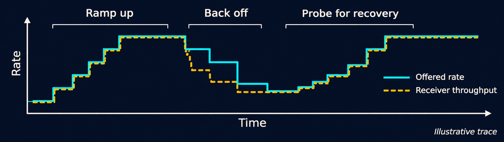

# 

How much traffic can your link carry when conditions change? EdgeWalker raises the sending rate in steps and checks what reaches the receiver. Each direction has its own controller and a ceiling you set.

## How EdgeWalker finds the edge



In this example, the solid blue line shows what the sender offers. The dashed yellow line shows what gets through. At first they climb together. When delivery falls behind, the sender backs off. It then tries small increases and checks the receiver again. As the link recovers, those probes let it find a higher sustainable rate.

[Install EdgeWalker](#install) · [Run your first calibration](#first-calibration) · [Run a measurement](#run-a-measurement)

The Rust engine handles network traffic. Python manages sessions, replays receiver feedback and writes reports. See the [design brief](docs/brief.md) for the requirements and [third-party notices](third-party/dependencies.json) for dependency licenses.

## Install

Use Python 3.11 or later on each endpoint. The launcher uses the standard library. Keep the extracted directory together so it can find the native engine and Python modules.

**Install a release archive** from the [private releases page](https://github.com/wattsie/EdgeWalker/releases). Download the archive and its matching `.sha256` to a new directory. Choose `darwin-arm64` for Apple silicon or `linux-aarch64` for 64-bit ARM Linux (Debian 12 build). From the download directory:

```sh
archive="edgewalker-0.2.0-$(uname -s | tr '[:upper:]' '[:lower:]')-$(uname -m).tar.gz"
case "$(uname -s)" in
  Darwin) shasum -a 256 -c "$archive.sha256" ;;
  Linux) sha256sum -c "$archive.sha256" ;;
esac
```

After the checksum reports OK, extract and check the installation:

```sh
tar -xzf "$archive"
cd "${archive%.tar.gz}"
python3 --version
./bin/edgewalker-native --version
./edgewalker calibrate --help
```

**Build from source** on a Linux or macOS host with Git, make, a C linker, Python 3.11+ and a current stable Rust toolchain with Cargo. On macOS the Command Line Tools provide make and the linker. On Debian-family Linux the `build-essential` package provides them. From a shell authenticated to the private repository:

```sh
git clone --branch v0.2.0 https://github.com/wattsie/EdgeWalker.git
cd EdgeWalker
make build
./target/release/edgewalker-native --version
./edgewalker calibrate --help
```

## First calibration

For a localhost check, start the server in one terminal. Generate the key once in a new private directory. For later runs, reuse that file.

```sh
(umask 077 && mkdir -m 700 lab && ./edgewalker keygen > lab/config.json) &&
  ./edgewalker server --config lab/config.json --listen 127.0.0.1:5207 --capacity 400000
```

Open a second terminal in the same installation directory. This example allows up to 400 kbps forward and 200 kbps return over a total of ten minutes.

```sh
./edgewalker calibrate --config lab/config.json --connect 127.0.0.1:5207 \
  --forward-max 400000 --return-max 200000 --duration 600 --output calibration-01
```

Read `calibration-01/evidence.json` before applying `plan.json`. Exit 2 with completed evidence files means at least one direction lacked support for a tuning change. Invalid command syntax can also exit 2. Apply the plan in a fresh run and inspect the report:

```sh
./edgewalker run --config lab/config.json --connect 127.0.0.1:5207 --mode udp \
  --plan calibration-01/plan.json --timing-every 0 --duration 120 --output verification-01
./edgewalker report verification-01
```

For two hosts, install on both, securely provision the same key, bind the server to its reachable data-interface address and use that address with `--connect`. Permit the TCP control port and selected test data ports between the endpoints. Set an explicit server data-port range with `--data-ports` if required by the firewall. Choose a new output directory for each command. Ctrl-C stops the foreground server. To uninstall an extracted copy, stop its processes and remove its directory after saving the records and key you intend to keep.

## Run a measurement

From the source checkout, run `make build` to build the Rust engine. With an extracted arm64 release package, run the included `./edgewalker` launcher directly. Both use Python 3.11 or later. Forward traffic travels from the server to the client. Return traffic travels from the client to the server.

- [First authenticated measurement](docs/operator.md#local-measurement) and [saved results](docs/operator.md#records-and-verification)
- [Test recipes](docs/operator.md#test-recipes) for forward UDP, return TCP, simultaneous combined traffic, loss recovery, a capacity change, and a bounded four-flow high-rate run
- [Command reference](docs/operator.md#command-reference) for launcher commands, native options and per-direction plan settings

## Source build and verification

Run these commands from the project root. Building uses the Rust/Cargo toolchain and the checked-in lockfile. Python orchestration, replay and reporting use the standard library.

| Command | Result |
|---|---|
| `make build` | Builds the release engine under `target/release/`. |
| `make check` | Checks formatting and Clippy, runs locked Rust tests, builds the debug engine, and runs the Python offline, native, operator and calibration loopback suites. |
| `make package` | Builds the host release engine, writes a versioned archive and SHA-256 file to `dist/`, and tests the extracted archive with a bounded authenticated localhost measurement. |
| `python3 -B scripts/package.py --output DIR` | Packages an existing host build. `--output` is required. `--engine FILE` selects a binary instead of `target/release/edgewalker-native`. `--cargo-metadata FILE` supplies locked dependency metadata for the license inventory, including vendored builds. `-h` or `--help` shows usage. Use a fresh output directory to preserve any earlier archive with that version. |

## Offline controller replay

The shipped replay reproduces rate decisions, reasons and state transitions from timestamped synthetic UDP receiver reports. The fixtures include reordering, stale feedback and a lossless plateau.

### Run the offline replay

From the project root, use Python 3 with its standard library.

```sh
./edgewalker replay examples/udp-replay.json
python3 -B -m unittest discover -s tests -v
```

The first command prints one JSON decision per line. The second checks expected decisions and compares the complete CLI output from two independent processes.

The [sample trace](examples/udp-replay.json) supplies provisional settings for one UDP stream per direction in loss-only mode. At 5,000 ms, forward receives sequences 1, 3, 2, 4. All four packets arrive, but sequence 2 has already counted as lost. Forward halves its offer to 3,200 bps while return independently increases to 8,000 bps. Later, forward probes 4,800 bps, falls back and revalidates 3,200 bps. A feedback gap then exercises hold, suspension and readiness before restart.

To write a trace, configure each active direction and list its events in arrival order on one monotonic millisecond clock. A feedback event describes a closed, post-settling interval for the stated offer. Supply the sender’s inclusive first and last sequence numbers, the receiver’s arrival order and its raw received byte count. Continue sequence numbering across rate changes and restarts. Adjacent intervals can qualify together when their sender ranges are contiguous. Output pairs the measured offer and receiver throughput with the new offer and decision reason. A null edge means the estimate needs fresh verification.

A `tick` advances time without feedback. Timeouts fire at their deadlines, before input at the same timestamp. A `ready` event models confirmation from an already authenticated receiver in the same active session. The trace ends after its last event. The sample uses a five-second clean window, three packets, early backoff at three losses in a window and zero settling time. These small counts make decisions inspectable. This fixture exercises loss-only control. The native integration suite exercises transport and session lifecycle.

### Replay a fixed lossless limit

```sh
./edgewalker replay examples/fixed-limit-plateau.json
```

The [plateau trace](examples/fixed-limit-plateau.json) keeps the configured ceiling at 9,600 bps and models a receiver that tops out at 6,400 bps. At 25 seconds the controller selects 6,400 bps, the lowest tested offer that delivered the maximum. It probes at 35 and 50 seconds. Both probes offer 7,200 bps, deliver 6,400 bps and return to the selected rate after a five-second measurement.

To exercise plateau detection, supply measured `excess_delay_us` in each feedback interval. The replay compares total received bytes per elapsed time across qualified lossless windows. Its provisional rule requires two higher offers without improvement, equal excess delay across the observations, and counts a gain of one whole bps as meaningful. Once it finds the plateau, one qualified probe window can confirm a gain or return the offer to the best operating point. Traces without delay evidence retain the original loss-only decisions. Field thresholds for meaningful gain and flat delay still need calibration.
